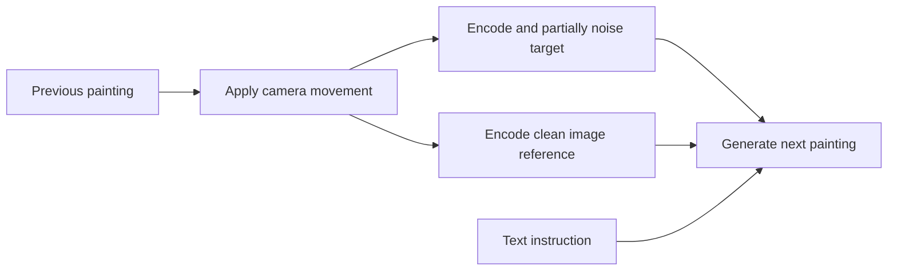

# Noise and clean references in recurrent image generation

2026-10-12. Source and implementation research for World Seed, recorded before new rendering. Olof prioritizes noise and reference conditioning, defers refinement, and rules out masks. This research phase did not download weights or submit inference. The subsequent approved execution and its evidence live in the [noise/reference study](../../apps/deforum/projects/world-seed/experiments/noise-reference/README.md).

## What happens in our current repaint

For each new painting, warp the previous generated RGB image, VAE-encode it, mix it with one fresh Gaussian noise tensor, then make three Euler updates. The 0.72 case uses `0.72 → 0.615413 → 0.373081 → 0`. Its next painting draws new noise and repeats. These internal sampler states are not the displayed video frames; RIFE supplies in-betweens afterward and never feeds back.

In our flow-model latent coordinates, initialization is `z_start = (1 - sigma) * z_warped + sigma * epsilon`. Thus 0.72 means coefficients 0.28 and 0.72 in this latent mixture. It does not mean 72% of visible pixels are replaced, nor quantify how much recognizable information survives. This differs from simply adding noise on top of an unchanged image signal. [Pinned Comfy flow mixing](https://github.com/Comfy-Org/ComfyUI/blob/12d5279438bfefc058a269eae805ceab6047777f/comfy/model_sampling.py#L77), [Krea model type](https://github.com/Comfy-Org/ComfyUI/blob/12d5279438bfefc058a269eae805ceab6047777f/comfy/model_base.py#L2551), [local schedule](../../apps/deforum/src/deforum_lab/rendering/schedules.py).

Olof's description of adding fresh randomness between denoising steps is valid for stochastic/ancestral samplers. Comfy's ordinary Euler defaults to zero churn and makes no fresh random draw inside its loop. Its Euler ancestral flow implementation draws additional noise on non-final transitions; the final transition ends without another random injection. Krea's official sampler also uses deterministic Euler updates after initial noise. These are different sampling methods, not a missing operation in our code. Adding step noise may change texture and trajectories, but it is not an established preservation improvement. [Pinned Euler and ancestral implementations](https://github.com/Comfy-Org/ComfyUI/blob/12d5279438bfefc058a269eae805ceab6047777f/comfy/k_diffusion/sampling.py#L169), [official Krea sampling](https://github.com/krea-ai/krea-2/blob/main/sampling.py).

Separate four controls when designing tests: initial noise strength, intermediate noise levels, stochastic draws within a repaint, and the noise sequence across successive paintings. The existing correlated-noise failures concern the last control; they do not test all sampler schedules or trained editing routes.

## What reference-aware editors do differently

There are two independent image inputs we can supply: the target canvas being denoised, and a reference that conditions the denoiser. An editor need not partially noise the reference itself to produce an output resembling it.

| Documented implementation | Target being generated | Reference path | What this establishes |
| --- | --- | --- | --- |
| Current Krea repaint | Partially noised warped previous painting | Text only; no additional image reference | Image information enters through initialization, but has no separate clean visual input during sampling. |
| FLUX.1 Kontext | Default pipeline creates target latents from random noise | Encoded image tokens are concatenated with target tokens at every model evaluation; only target predictions update the target | Source preservation can be learned through context rather than low starting noise. |
| FLUX.2 reference sampling | Target evolves through Euler updates | Separate image-conditioning tokens are appended at each step; predictions for them are discarded | The same broad separation also appears in this newer family; it is not specific to one older editor. |
| Qwen Image Edit / Edit Plus | Default Edit Plus pipeline starts target latents from noise | Source goes through both a vision-language route and VAE appearance encoding; reference latents are appended, while only target latents are sampled | Semantic and spatial appearance conditioning complement editing/reconstruction training. |
| Community Krea Identity Edit v1.2 | Author workflow starts from noise; our proposed hybrid would retain partial-noise initialization | Image-grounded Qwen3VL text plus separate source VAE tokens through the matching model patch | Closest candidate to our Krea renderer, but its use in repeated surreal-world repainting is unvalidated. |

The FLUX.1 Kontext report describes training on image/instruction/target relationships. Qwen's report adds reconstruction tasks alongside editing and generation. This training is a substantive difference from asking a text-to-image model to recover a noisy starting canvas. Their default full-noise targets demonstrate why a scalar `strength` cannot be compared across ordinary img2img and reference editing as if it meant the same operation. [Kontext paper, section 3](https://arxiv.org/html/2506.15742v1#S3), [Qwen report](https://arxiv.org/html/2508.02324v1).

The lower image path is the proposed addition. No mask, source-pixel copyback or output compositing is involved. “Clean” means no deliberate diffusion noise was applied to the reference; VAE encoding and resizing can still lose information. Clean reference values do not imply every architecture uses timestep zero for reference tokens: the audited Krea edit patch applies a shared timestep modulation to its combined sequence. Use the matching trained node contract, not assumptions copied from native `index_timestep_zero` or another model.

Public mechanisms do not establish proprietary models' exact schedules. These examples explain available approaches, not a ranking of the newest or best editor. The papers' iterative editing examples and identity metrics are not tests of nine closely spaced paintings per displayed second in our renderer.

## What we have already tried

- [September 8 additive-reference study](../../apps/deforum/projects/modern-model-study/experiments/additive_reference.md) did retain the recurrent previous-image initialization and added optional references for Krea and Klein. Krea used a **style-reference** adapter; the reference was the previous painting **before** warping. It did not prevent the explorer disappearing or the arch changing. Both Krea branches flattened. It also used a different opening, resolution, quantization and eight-step schedule from the current film. An earlier `conditioning.py` test used empty target latents and must not be treated as our recurrent baseline.
- [September 13 FP8 reference screen](../../apps/deforum/projects/modern-model-study/experiments/reference-screen.md) separated encoder, style-adapter and reference changes in one-repaint probes. It found no clear preservation advantage and stopped there.
- These are real reference experiments. The missing test is an editing/preservation-trained reference route on the current detailed artwork and then in recurrence. Do not say reference inputs have never been tried, or repeat the same style-adapter test under a new name.

## Reference policy matters for video

For the first hybrid test, use the **same already-warped previous painting** for both initialization and reference. It agrees with the intended camera coordinates and introduces no second spatial history. Using the unwarped previous painting creates a possible conflict between preservation and motion. This is a hypothesis about the old test's limitation, not a proven explanation of its failure.

Referencing the latest painting can reduce local redesign but cannot recover detail that has already disappeared from that painting. A fixed scene keyframe can provide older detail, but risks pulling the image back toward the old viewpoint or preventing intended transformations. Compare that policy later, with geometry aligned and a reference reset at an intentional world change. Multiple references require training that supports their roles; more reference inputs are not automatically more stable.

There is no sequence-level memory just because we repeatedly call an image editor. Each call knows only its supplied images and text. We must test drift, motion compliance, texture shimmer and deliberate transformation separately. A frozen-looking or flattened output does not pass merely because it keeps the moon.

## Proposed staged comparison

Use preserved native **1536×1024** openings `tidal-specific-b` and `city-full-material-a` from [the prompt study](../../apps/deforum/projects/world-seed/experiments/prompt-study/README.md). Both files exist locally. Keep the 2016×1344 city out of this study: changing resolution would confound the comparison and exceed the edit adapter author's recommended 2MP range. Preserve all prompts, images, noise/seed records, sigma lists, parent hashes and model/node revisions.

### 1. Isolate the noise schedule before adding an adapter

Our previous noise sweep scaled **every nonzero level**, not only initialization. A small same-cost comparison can distinguish those choices:

| Arm | Sigma sequence, rounded for display | Question |
| --- | --- | --- |
| N60 | 0.60 → 0.512844 → 0.310901 → 0 | Current acceptable baseline |
| N72-scaled | 0.72 → 0.615413 → 0.373081 → 0 | Existing 0.72 treatment |
| N72-fixed-tail | 0.72 → 0.512844 → 0.310901 → 0 | Same initial mixture and three updates as N72-scaled, but original lower sampling levels |

Use the same actual starting noise at matching comparisons, Euler with zero churn, CFG1, full material prompt, dimensions and input. Two openings × two seeds × three arms gives **12 single-repaint probes**, with archived outputs reused only after exact control parity. This tests schedule placement; it does not add a second detail pass. A larger first jump could help or hurt. None is claimed to be an official recurrent schedule.

Then inspect a short genuine recurrent chain for a promising candidate against its control. Each branch must use its own previous output. Screen no-motion retention first and then the same smooth pan/zoom/bank, using all source paintings and dense RIFE windows. Do not promote a first-repaint improvement to video quality. Fresh per-step stochastic noise is a separate lower-priority test: introducing it simultaneously would confound the schedule/reference questions and lacks a demonstrated retention advantage here.

### 2. Establish a working editing-reference path

Use the current Krea Turbo assets with **Identity Edit v1.2** and its matching node package in an isolated experiment. First verify the author's supported full-generation workflow: same clean reference, eight Euler steps, CFG1, appropriate edit instruction and recorded reference boost. Two artworks × two seeds gives four feasibility probes. This full-noise target is an explicit installation/capability control, not a silent replacement of the recurrent initialization.

The author workflow requires `Krea2EditGroundedEncode` and `Krea2EditModelPatch`, model-only LoRA loading and source VAE encoding. For the hybrid, retain `VAEEncode(warped previous painting)` as sampler initialization and connect the same target latent to the patch's geometry input. The reference gets both the VAE and vision-language paths. No `ref_boost_mask` is connected. `ref_boost=1` means ordinary reference attention, not reference disabled; a value recommended for faces is not an established landscape optimum. These are source-audited requirements; runtime compatibility and quality remain to be tested.

Only after supported editing works, test partial-noise **hybrid** initialization using the noise study's selected schedule, alongside unchanged current-recipe controls. Loading an edit adapter, its encoder route and reference together tests a complete editing recipe; it does not isolate “reference alone.” An adapter-without-reference arm would be outside its normal training contract and should not be treated as a validated baseline.

If the native eight-step editing control works but the three-update hybrid fails, run a matched-start eight-update hybrid before rejecting reference conditioning. Freeze its exact sigma sequence before inference and keep all other settings constant. More steps are not a promise of better quality; this check distinguishes a partial-sampling adaptation failure from an editing-capability failure.

Start with the complete scene/material description plus one fixed preservation instruction. Any comparison with a shorter edit-oriented instruction must be a separate prompt arm. Once holding quality is useful, introduce one deliberate small transformation to ensure the reference does not suppress the film's purpose. Do not tune prompts, reference weight, noise and scheduler simultaneously to rescue an unexplained failure.

### 3. Extend only a promising recipe

Compare unchanged baseline and selected candidate in short continuous clips on both worlds, with two seed trajectories if affordable. Judge major-object count/silhouette, the planned camera trajectory, fine relief and highlights, and unwanted changes between adjacent paintings. Inspect raw paintings before interpolation; RIFE cannot restore a missing source object. Require a visible detail/continuity improvement without pasted boundaries or frozen composition. Keep the original film selected until human review.

Refinement is deferred until these noise/reference questions have been tested. Higher native resolution is also separate. No generation or architectural implementation was started during this research phase.

## Primary implementation sources checked

Context7 was used to locate Diffusers documentation; implementation claims above were checked in primary source, not inferred from pipeline names or generic strength advice. Exact GitHub revisions were resolved on 2026-10-12:

- **Diffusers `883d51ef02cd7972eeaf158c652d229f3459f419`:** [Kontext](https://github.com/huggingface/diffusers/blob/883d51ef02cd7972eeaf158c652d229f3459f419/src/diffusers/pipelines/flux/pipeline_flux_kontext.py), [Qwen Edit Plus](https://github.com/huggingface/diffusers/blob/883d51ef02cd7972eeaf158c652d229f3459f419/src/diffusers/pipelines/qwenimage/pipeline_qwenimage_edit_plus.py). Both initialize random target latents separately, concatenate encoded reference latents during denoising, slice predictions to the target and update only that target.
- **BFL FLUX.2 `50fe5162777813d869182b139e83b10743caef15`:** [sampling implementation](https://github.com/black-forest-labs/flux2/blob/50fe5162777813d869182b139e83b10743caef15/src/flux2/sampling.py). The conditioning sequence is appended for evaluations and excluded from target updates.
- **Krea edit nodes `86f886dac23013d88996e3a2e99093ba44d322fb`:** [implementation](https://github.com/lbouaraba/comfyui-krea2edit/blob/86f886dac23013d88996e3a2e99093ba44d322fb/__init__.py), [wiring and limitations](https://github.com/lbouaraba/comfyui-krea2edit/blob/86f886dac23013d88996e3a2e99093ba44d322fb/README.md). Source blocks precede the target; only target predictions are returned. The recorded source pixels/latents are not noised by the target sampler.
- **Identity Edit card `89e9e7a09ee2e5c9331e952063d79b1b8a703280`:** [author guidance](https://huggingface.co/conradlocke/krea2-identity-edit/blob/89e9e7a09ee2e5c9331e952063d79b1b8a703280/README.md). Community model, not official Krea; claims editing preservation but acknowledges unintended changes and unusual-content drift. The report does not establish performance on surreal worlds or recurrent video.

The older [reference audit](krea-reference-continuity.md) retains weight hashes and historical graph alternatives; its proposed style-reference screen subsequently completed. Its old per-session no-install/no-download boundaries are historical, not current user instructions.
